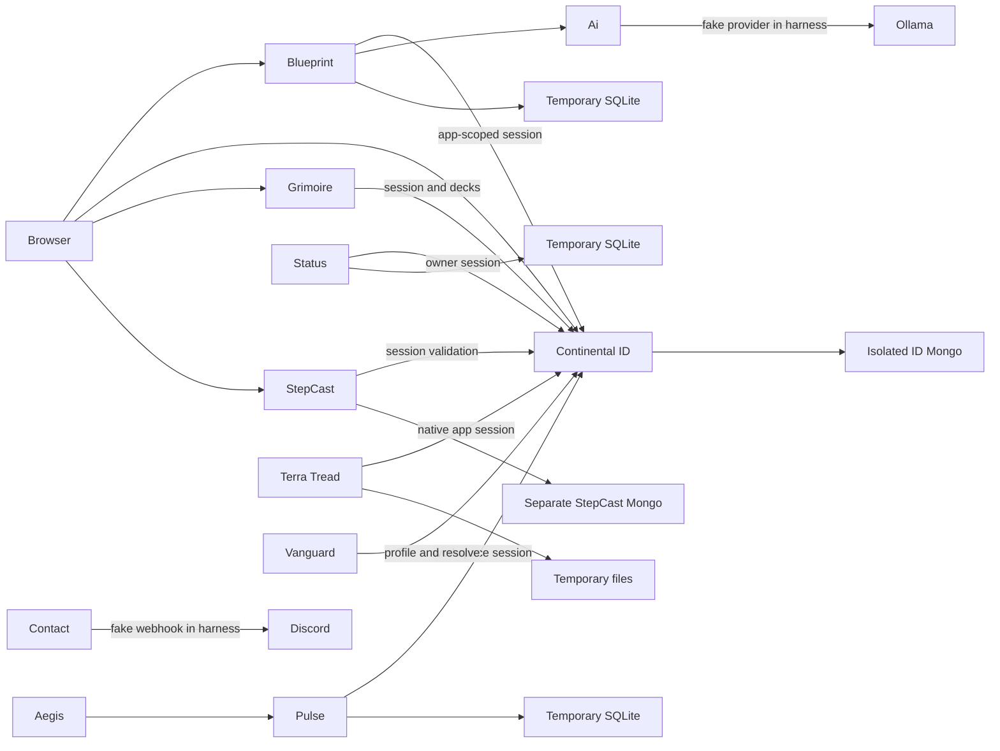

# Continental ecosystem integration

## Scope

Continental services are treated as independently deployed processes. The harness uses local loopback listeners, ephemeral ports, temporary working directories, isolated databases, and fake external providers. It does not connect to production accounts, databases, Discord, or Ollama.

`ecosystem/` is the executable catalogue of boundaries that have been exercised. The diagram below describes that catalogue and the inspected service relationships; it is not a complete production Status catalogue.



## Trust and coupling

| Coupling | Verified behavior |
|---|---|
| Explicit API contracts | ID profile, login, bootstrap, logout, linking and app-hosted deck APIs; Ai; Pulse; contact webhook; StepCast; Terra Tread. |
| Application scope | ID signs tokens for an exact application origin. Consumers send their configured origin to `/api/auth/me` and reject another origin or management scope. |
| Shared client | Continental ID popup/bootstrap helpers have a source package, a pinned Blueprint copy, and older copied implementations that can drift. |
| Shared data | ID-hosted Grimoire decks use the ID service database. No direct cross-service database reader was found in the certified set. |
| Runtime configuration | Origins, application IDs, API URLs, signing/session settings, service keys, callback URLs, and timeouts must agree across deployments. |
| Implicit assumptions | Stable ID field placement, linked Discord identity shape, provider availability, public origin, cookie policy, and timeout coverage through response-body reads. |

Production database URI separation has not been verified. Production environment files were not read.

## Contract inventory

“Exercised” means covered by the local harness or an affected project test. It does not certify a production deployment or a historical release pairing.

| Interface | Authentication and request | Response and failure contract | Timeout and status |
|---|---|---|---|
| ID login `POST /api/auth/login` | JSON credentials and intended `targetOrigin`; trusted browser Origin. | Returns a short-lived token and refresh cookie on success. Invalid credentials, verification, suspension, MFA, and throttling have explicit states. | ID tests cover the route; ecosystem tests use seeded verified accounts. Public registration and email verification are not part of the ecosystem browser journey. |
| ID bootstrap `POST /api/auth/bootstrap` | JSON `{ appId, accessToken }`; registered app Origin. | Returns an app-scoped access token and `authContext`; disabled, unknown, mismatched, or cross-app requests fail closed. | Exercised through real ID with each consumer process. |
| ID profile `GET /api/auth/me` | `Authorization: Bearer …`; relying service sends its configured application Origin. | Requires a live session and matching scope. App profiles expose a stable `userId`; selected apps receive limited additional fields. Missing or invalid scope is rejected. | Provider calls use bounded response reads in consumers; caller-specific deadlines are documented below. |
| ID refresh/logout | `POST /api/auth/refresh_token` and `POST /api/auth/logout`, cookie and trusted Origin; refresh may name a target origin. | Refresh rotates the server session; logout revokes it. CSRF and Origin checks apply to browser cookie mutations. | Browser cookie refresh, logout, and revocation are exercised. Host-only refresh cookies are intentional. |
| ID Discord link | `POST /api/auth/oauth/discord/link-start`, callback `GET /api/auth/oauth/discord/callback`, and `DELETE /api/auth/oauth/discord`. | Requires management scope, current-password confirmation, one-time browser-bound state and provider ID stability. Duplicate ownership returns a stable conflict. | Discord HTTP provider is fake. Live OAuth registration, guild access, and gateway behavior are untested. |
| ID Vanguard resolve | `POST /api/vanguard/users/resolve` with the configured Vanguard service key. | Resolves a Discord-linked account; missing service credentials are rejected. The key is not an owner credential. | Blueprint integration and the Python Vanguard consumer exercise the resolve path. Flag/unflag/license authorization is not covered by the ecosystem harness. |
| Blueprint sign-in | `POST /auth/continental/start`, `POST /auth/session`, then protected account routes using the local HttpOnly session cookie and CSRF token for mutations. | Callback state is one-time; session establishment checks the real ID profile and local account identity. Logout is local and protected content requires the cookie. | Configured request deadline; tests cover replay, CSRF, logout, identity revocation, suspension, and deletion. The browser test blocks external traffic. |
| Status owner API | `GET /api/internal/status` with an ID app-scoped bearer token. Public status is `GET /api/v2/status`; liveness is `GET /live`. | Current authority is loaded from ID; role edits in the client are not trusted. ID outage fails owner access closed and degrades dependent health. Public responses omit private diagnostics. | Provider probes have per-probe timeouts and health thresholds. Owner revocation and incident recovery are exercised. |
| Contact form | `POST /api/contact` JSON; external delivery uses the configured Discord webhook. Health is `GET /api/health`. | User mentions are suppressed before webhook delivery. Non-success, redirect, and unavailable-provider cases do not wait indefinitely. | Five-second delivery deadline covers the response body. Webhook is fake. |
| Pulse workspace | `GET /v1/workspace` and `POST /v1/projects` with an ID bearer token; project collection uses `POST /v1/collect`. | Workspace/project access is account-scoped. Invalid, malformed, or unavailable ID identity returns structured `identity_unavailable` service failure rather than invalid credentials. | Auth and response bodies are bounded. SQLite is temporary; project ownership and outage/recovery are exercised. |
| Aegis collector | `POST /api/pulse/collect`; Aegis forwards events to Pulse. Health proxy is `GET /api/pulse/health`; service liveness is `GET /api/health`. | Forwarded collection retains the Pulse schema; upstream errors, redirects, oversized responses, and unavailable Pulse are bounded. | Configurable timeout remains active through body reads. Real Aegis and Pulse processes run locally. |
| Ai adapter | `POST /chat` or `/ask`; Blueprint sends configured AI requests. | Adapter response shape is consumed by Blueprint. The harness provider returns a fixed fixture answer; entitlement and external provider behavior are not certified. | Configurable request deadline. Streaming and reset behavior remain open. |
| StepCast auth/walks | `GET /api/auth/protected` and `/api/location` with an ID bearer token and configured StepCast Origin. | Stable string subject is accepted in current and legacy response placements. Walk ownership is derived from the verified ID; a request body cannot transfer a walk. | Timeout covers response-body reads; redirects are rejected and body size is bounded. StepCast Mongo is separate from ID Mongo. |
| Grimoire decks | `GET /api/grimoire/decks` with a Grimoire-scoped bearer token. | A token for another application cannot read Grimoire decks. Deck ownership is tied to the authenticated ID account. | Client deadline remains active through body reads. Full cloud sync and multiplayer are not certified by this contract. |
| Terra Tread cloud | `GET/PUT /api/game/state/:userId`, `POST /api/game/steps`, `GET /api/game/steps/:userId`, `POST /api/game/streaks/:userId/claim`; legacy `/steps` routes are also protected. | Each request validates its bearer with ID under the registered `terra-tread` application origin. The server derives ownership from ID, rejects path/body identity mismatch, and does not accept management tokens. Guests remain local-only. | Configurable ID-validation deadline covers the response body; redirects and oversized profiles fail closed. Its file store is temporary in the harness. Debug and Release use HTTPS; production certificate and TLS termination still require deployment verification. |

### Shared identity schema

- Stable IDs are strings. Numeric IDs and arbitrary coercion are rejected.
- Consumers tolerate harmless additive response fields and reject absent or invalid identity/scope fields.
- Tokens are checked for issuer, audience, type, expiry, server-side session revocation, and application scope by ID.
- A 30-second consumer clock advance remained compatible with centralized ID validation. Issuer/verifier skew, `nbf`, and large-skew rejection have not been established.
- Access tokens are kept in memory by the Terra Tread native app. Persisted profile data does not contain the bearer token.

## Harness and evidence handling

The harness starts ID, Blueprint, Status, Contact, Pulse, Aegis, Ai, StepCast, and Terra Tread processes. It seeds only disposable verified accounts, application registrations, roles, and sessions. ID and StepCast receive separate Mongo databases; Blueprint, Status, and Pulse use separate temporary SQLite files; Terra Tread writes under a temporary directory. The optional Caddy process has no admin API or automatic HTTPS and uses temporary storage.

External Discord OAuth, Discord webhook delivery, Discord gateway readiness, and Ollama are faked. No child process is allowed to make non-loopback network requests. Startup failure cleanup tracks service PIDs and the disposable Mongo process. Test evidence is written under `/tmp/continental-ecosystem-*`.

`ecosystem/collect-evidence.cjs` emits sanitized JSON reports and an optional screenshot of the fixture browser account. It omits databases, service logs, process IDs, request query strings, and credentials. Do not upload entire temporary evidence directories.

## Running locally

Run from the Dashboard checkout. Requirements: Node 22.13 or later, repository dependencies, Vanguard Python dependencies in `discord-bots/.venv`, Chromium, and the MongoMemoryServer binary. Caddy is optional. The first MongoMemoryServer run may download its disposable test binary.

```sh
# Contract compatibility matrix
npm --prefix ecosystem run test:contract

# Process-boundary services
npm --prefix ecosystem run test:ecosystem

# Dependency failures and recovery
npm --prefix ecosystem run test:chaos

# Real browser popup journey
npm --prefix ecosystem run test:browser

# Contract, service, chaos, browser, and startup-cleanup suites
npm --prefix ecosystem run test:all
```

`test:all` runs the contract tier and the combined process suite. `ECOSYSTEM_ROOT` overrides the default `/home/charlie` repository root. `PLAYWRIGHT_CHROMIUM_PATH` may select a specific browser binary. The tests use only temporary databases and local ports; never point them at production.

The service-level checks are:

```sh
npm --prefix backend test
npm --prefix ../blueprint test
npm --prefix ../status test
npm --prefix ../pulse test
npm --prefix ../Aegis test
npm --prefix ../Grimoire test
npm --prefix ../StepCast/backend run check
npm --prefix ../Terra-Treck/backend test
```

## Latest local validation

Validated on 2026-10-08 against the working trees listed below:

| Check | Result |
|---|---:|
| Contract compatibility matrix | 3/3 passed |
| Combined process, browser, chaos, Caddy, Terra ownership, and cleanup suite | 30/30 passed; 0 skipped |
| Dashboard backend | 95/95 passed; syntax, lint, and typecheck passed |
| Blueprint | 90/90 passed; syntax, lint, and type checks passed |
| Status | 43/43 passed; lint and type checks passed |
| Pulse | 25/25 passed; build passed |
| Aegis | 18/18 passed |
| Grimoire | 40/40 passed; server build and lint passed |
| Terra Tread backend | 2/2 passed; syntax and lint checks passed |
| StepCast backend | check passed |
| Ai and Vanguard | JavaScript syntax and Python AST checks passed |

The native iOS code was not compiled because Swift and Xcode are unavailable in the validation environment. The run report records each repository's checked-out `HEAD` and a dirty flag. A dirty flag means the tested source also contained uncommitted changes, including pre-existing work; the SHA alone cannot reproduce that working tree. No production account or database was used.

After that ecosystem run, the current Dashboard backend was revalidated with a clean `npm ci`: 97/97 tests passed, and syntax, lint, typecheck, and dependency audit passed. The cross-repository process suite was not rerun against that later Dashboard source snapshot.

| Repository | HEAD at run | Dirty |
|---|---|:---:|
| Dashboard | `9b4d524806515120c025799336cc17c55286e6cd` | yes |
| Blueprint | `fe77e12636166e972e17bdf3605bf39584537e8f` | yes |
| Status | `61fbb4e3f6e662f7f51090e14944f70f27ca54ee` | yes |
| Contact | `2049ec9be379b313085ad984500d1b01e70e586e` | yes |
| Pulse | `00fe4348e03b08db05f9a7fe58cace57cec8dbbb` | yes |
| Aegis | `2263fb4719070a424a7b63b57ab90be12946b609` | yes |
| Ai | `d0b454ac73a9b4a67a12f40e3362e7affc230ca8` | yes |
| Vanguard (`discord-bots`) | `db461b10d89176e1f36fc0bbeebf3d01bfae8d10` | yes |
| Continental ID client | `d74f02e4c24ffb93e2753e64f414fe16006f5f8e` | no |
| Grimoire | `19a51a0d9e98d9d92a835335993ff97e1d8e63de` | yes |
| StepCast | `5e78acaf7eeb88696f3404283494f3bead074f51` | yes |
| Terra-Treck | `29d18f35da21ca71e8f85bcdaf523f2fbc7a8493` | yes |

## CI

`.github/workflows/ecosystem-integration.yml` is manually dispatched or reusable. Every repository revision is a required full commit SHA; branches and floating tags are rejected. This makes release combinations reviewable and repeatable. The workflow checks out the harness and all tested consumers at those exact commits, installs isolated test dependencies, runs project checks plus the real-process suite, and uploads only sanitized reports and the fixture screenshot. For private repositories, provide an `ECOSYSTEM_REPOSITORY_READ_TOKEN` secret with read access to each repository.

CI cannot test uncommitted work. Commit the intended source snapshots to accessible repositories, then pass those commit SHAs.

## Release compatibility and limits

This suite describes the checked-out source combination, not a universal provider-first or consumer-first deployment order. Historical release pairs and migration sequences remain untested. Consumers that require `authContext` intentionally fail closed when an older provider omits it; copied or pinned shared clients may lag the canonical package. Supported releases should be listed as explicit tested SHA pairs.

The ecosystem harness does not certify public registration/email verification, live external OAuth, provider account deletion, guild permissions, real Discord gateway readiness, Google/Microsoft/GitHub production callbacks, passkey browser privacy behavior, production TLS/DNS/Caddy, native iOS execution, or the Grimoire multiplayer process. The native app source was updated, but this Linux environment has no Swift/Xcode toolchain, so the iOS target was not compiled here.

Remaining work includes broader browser CORS/CSRF/cookie behavior, modest sustained-load and caching checks, migration-version fixtures, AI streaming/reset tests, Vanguard flag/unflag/license authorization, optional-service restart tests, and the Grimoire cloud/multiplayer journeys.
